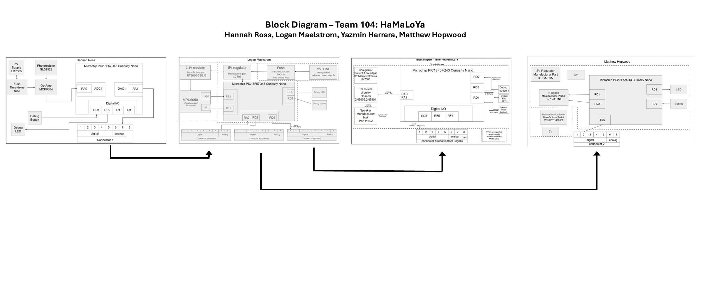

## Introduction: Team Block Diagram for HaMaLoYa Team 104
The block diagram follows the wheel and spoke design, with subsystem 2 - Logan's block - acting as the center of the wheel. The design is set up so there can be two sensors to detect a drowsy driver and two actuators to alert the user. The first subsystem is a photoresistor, detecting how light the surrounding area is. This will help the device detect nighttime as to avoid false alerts during the day. The second subsystem has an accelerometer to detect any jerky motions, like a driver falling asleep. The third subsystem uses a speaker to make a loud noise and keep the driver awake. The final subsystem uses a motor to cause haptic feedback and wake the user up. The wheel and spoke design was chosen so there can be two different checks with the sensors before both actuators go off at the same time.

The ribbon connections are numbered based on which spoke of the wheel they connect. Connection 1 is between Hannah's and Logan's boards, with an analog signal going through pin 7. Connection 2 is between Logan's and Matthew's boards, with a digital signal going through pin 3. Connection 3 is between Logan's and Yazmin's boards, with a digital signal going through pin 1. All pin 8s are connected to a unified ground to keep the system from short circuiting.

## Block Diagram Image

## Markdown
[Download the Draw.io source file](image/BlockDiagramTeam304.drawio)
